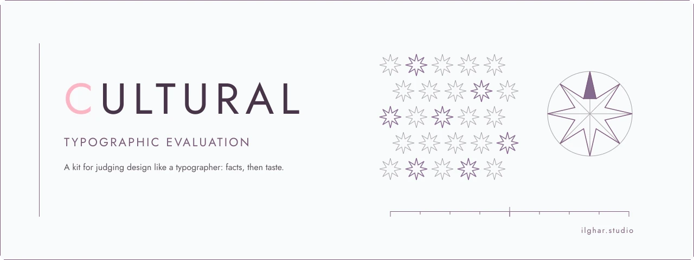

  <a href="https://ilghar.github.io/cultural-typographic-ai-evaluation/">
    <picture>
      <source media="(prefers-color-scheme: dark)" srcset="docs/hero/hero-dark.webp">
      
    </picture>
  </a>

# Cultural typographic evaluation

A kit for judging design like a typographer: facts first, then taste.

Open the live app: [ilghar.github.io/cultural-typographic-ai-evaluation](https://ilghar.github.io/cultural-typographic-ai-evaluation/) · Repository: [Ilghar/cultural-typographic-ai-evaluation](https://github.com/Ilghar/cultural-typographic-ai-evaluation)

## How it's used

Give it a cleared brief with checkable constraints and a candidate artifact. Factual checks run apart from taste ratings: glyphs, reading order, grid math, keycaps, and Persian-script lint. It returns pass, fail, or uncertain with evidence, and flags rater disagreement for a person.

The live page includes a glyph check you can run in the browser.

[ilghar.studio](https://ilghar.studio)
