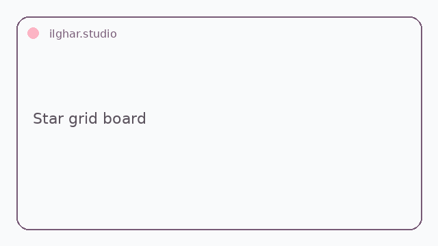
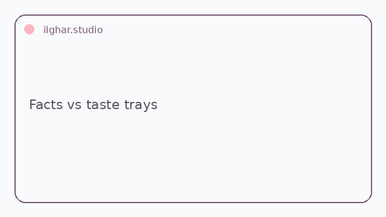

<!-- Copy to the top of every README. Replace REPO, files in docs/hero/. -->

  <a href="https://ilghar.github.io/cultural-typographic-ai-evaluation/">
    <picture>
      <source media="(prefers-color-scheme: dark)" srcset="docs/hero/hero-dark.svg">
      
    </picture>
  </a>

<b><a href="https://ilghar.github.io/cultural-typographic-ai-evaluation/">OPEN THE LIVE APP</a></b> | <a href="#how-it-works">HOW IT WORKS</a>

<!-- Function previews: one per app function, GIF/SVG, each linking into the live app -->
| <picture><source media="(prefers-color-scheme: dark)" srcset="docs/hero/f1-dark.gif"></picture> | <picture><source media="(prefers-color-scheme: dark)" srcset="docs/hero/f2-dark.gif"></picture> |
|---|---|

## How it works
- Give it a cleared brief with checkable constraints and a candidate artifact.
- Factual checks run apart from taste ratings: glyphs, reading order, grid math, keycaps, and Persian-script lint.
- It returns pass, fail, or uncertain with evidence, and flags rater disagreement for a person.

ilghar.studio
