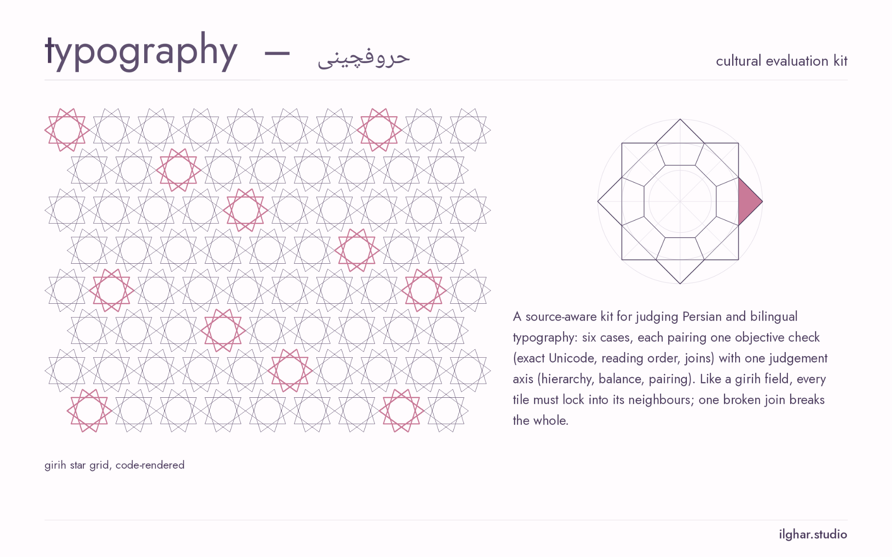

# cultural & typographic evaluation kit

**A kit for judging generated design work the way a typographer would: first the facts you can check (the right Persian letters, the right reading order, the grid that actually adds up), then taste, kept separate and allowed to disagree.**



*Project board, ilghar.studio. Light and dark versions follow the page theme.*

## The question
> How can evaluators separate factual cultural/typographic constraint failures from subjective aesthetic preference, while documenting disagreement and source provenance?

Image and layout generators produce posters, cards and keyboards that look plausible and are quietly wrong. Persian keycaps with the same letter printed four times. An Arabic kāf where Persian needs keheh. A missing zero-width non-joiner that breaks a word in two. A template whose inside margin is 37.89 pt while every other margin is 36. A literary or cultural object dropped in as decoration, with no reason to be there.

Most evaluations fold all of this into one “quality” score, so a factual error and a matter of taste end up on the same scale, and the people who notice the error are outvoted by the people who liked the colours.

This kit keeps the two apart. Factual constraints are checked by deterministic code at the level of Unicode code points and arithmetic. Aesthetic judgements are collected from raters as distributions, never averaged into a verdict, and disagreement is flagged for adjudication. Rater identity is never used as evidence of expertise: an annotation that carries a nationality field is rejected.

## Who it is for
- **Teams evaluating image, layout or type generators:** Code-point-exact checks for Persian and mixed-direction text, and a clear line between “wrong” and “I don’t like it”.
- **Designers and art directors:** A grid checker that tells you whether margins, gutters and baseline really form the square, rhythmic module you asked for.
- **Annotation and research leads:** Annotation schemas that preserve minority opinions and uncertainty, and refuse identity-based shortcuts.

## How it works
1. **Cleared brief + constraints.** Each case states what must be true (exact title glyphs, reading order, required fields, diagram stages) and records rights and review status for every reference.
2. **Candidate artifact.** Original or licensed examples only. The vertical slice renders a right-to-left SVG card from a spec, with native text, never text baked into pixels.
3. **Factual checks.** Exact-glyph, reading-order, required-field and diagram checks return pass, fail or uncertain with evidence. Anything that needs eyes is marked human-review, never guessed.
4. **Taste, separately.** Aesthetic axes such as hierarchy are collected as rating distributions with n, not merged into the factual verdict.
5. **Disagreement and adjudication.** Conflicting rater verdicts are flagged for adjudication. Malformed or identity-bearing annotations are rejected with reasons.
6. **Grid and keyboard checks.** The grid checker verifies margins, gutters, square modules and baseline rhythm by arithmetic; the keyboard checker checks Persian keycaps for duplicates, look-alikes and missing letters.
7. **Script linter.** The script linter walks every string in an evaluation output and flags codepoint-level Persian-script faults: Arabic yeh/kaf (U+064A, U+0649, U+0643) where Persian U+06CC/U+06A9 are expected, misplaced or repeated ZWNJ, bidi control characters, mixed digit sets, and a labelled heuristic for a missing ZWNJ after the mi-/nemi- verb prefix. Rules follow the character-level guidance in [W3C Arabic & Persian Layout Requirements](https://www.w3.org/TR/alreq/). It reports characters, not language quality; exit 0 clean, 1 findings, 2 bad input.

Stages (see `docs/architecture.mmd`, authoritative, and `docs/architecture.svg`): Cleared brief + reference constraints → Original or licensed candidate example → Separate factual and aesthetic rubric axes → Independent annotation + uncertainty → Adjudication without identity-based inference → Versioned evaluation report and design examples


*Facts on one side, taste on the other, and a ruler between them.*

## Commands, with real output
### `cultural-typographic-ai-evaluation report fixtures/synthetic_eval_m03.json --out out/`
Run factual checks and aggregate annotations for two synthetic cases. X01 is a deliberately broken card.

```
{"X01": ["fail", "fail", "fail", "uncertain"], "X02": ["pass"]}

X01 evidence (from out/report.json):
  title   fail  ZWNJ count 1 expected, 0 observed; Arabic ARABIC LETTER KAF used where Persian ARABIC LETTER KEHEH expected
  order   fail  expected [rtl:عنوان, ltr:2026] observed [ltr:2026, rtl:عنوان]
  fields  fail  missing: venue
  ref     uncertain  artifact lacks data for this constraint
  raters  ref: 1 pass / 1 fail -> needs_adjudication
  rejected r3: forbidden identity field rater_nationality; rating out of range on hierarchy
```

### `cultural-typographic-ai-evaluation slice inputs/synthetic_cases.json --specs fixtures/card_specs_m04.json --out out/m04`
Vertical slice: render RTL SVG cards from specs and run the checks on them. Cases without an automatable spec stay empty rather than pass.

```
{"C01": ["pass", "pass", "pass"], "C02": ["pass", "pass", "pass"], "C03": [], "C04": [], "C05": [], "C06": []}
```

### `cultural-typographic-ai-evaluation collection . --out out/c`
Validate the case collection and list which constraints per case can be checked by code.

```
{"errors": [], "automatable": {"C01": ["glyph_exact"], "C02": ["required_fields", "reading_order"], "C03": [], "C04": [], "C05": ["reading_order", "glyph_exact"], "C06": ["diagram_fidelity"]}}
```

### `cultural-typographic-ai-evaluation baseline . --out out/b`
Corruption suite: inject known errors (Arabic kāf/yeh, dropped ZWNJ, swapped order, invented metric) and measure detection.

```
{"detection": {"detected": 15, "denominator": 15, "value": 1.0}, "false_positives_on_clean": {"count": 0, "denominator": 4}, "by_variant": {"arabic_kaf": {"detected": 2}, "arabic_yeh": {"detected": 2}, "drop_stage": {"detected": 1}, "drop_venue": {"detected": 3}, "drop_zwnj": {"detected": 1}, "invented_metric": {"detected": 1}, "swap_order": {"detected": 1}, "title_moved_last": {"detected": 3}, "zwnj_to_space": {"detected": 1}}}
```

### `cultural-typographic-ai-evaluation failure --out out/f`
Adversarial suite for checks and aggregation (bidi controls, Persian digits, percent signs, malformed annotations).

```
{"passed": "28/28"}
```

### `python3 -c "from cultural_typographic_ai_evaluation.grid import check_grid; ..."`
The recorded A4 template: 6×9 grid, 12 pt gutter, margins declared equal but inside set to 37.89 pt.

```
{"verdict": "fail", "findings": [{"check": "equal_margins", "verdict": "fail", "evidence": "declared equal but got {'top': 36, 'bottom': 36, 'inside': 37.89, 'outside': 36} pt"}, {"check": "square_modules", "verdict": "fail", "evidence": "module 76.898 x 74.877 pt (difference 2.021)"}], "derived": {"text_area": [521.386, 769.89], "module": [76.898, 74.877]}}
```

### `python3 -c "from cultural_typographic_ai_evaluation.keyboard import check_keys; ..."`
A synthetic 33-key Persian layout with one Arabic kāf and dāl printed three times.

```
{"verdict": "fail", "n_keys": 33, "n_missing": 2, "findings": [{"kind": "arabic_lookalike", "key": 30, "evidence": "ARABIC LETTER KAF used; Persian needs ARABIC LETTER KEHEH"}, {"kind": "duplicate", "key": "9,31,40", "evidence": "U+062F appears on 3 keys"}, {"kind": "missing", "key": null, "evidence": "U+0647 U+06CC"}]}
```

### `python3 -m cultural_typographic_ai_evaluation.script_lint tests/fixtures/script_lint/dirty.json`
Lint a synthetic fixture of deliberately broken Persian strings (not model output). Reference: [W3C Arabic & Persian Layout Requirements](https://www.w3.org/TR/alreq/).

```
tests/fixtures/script_lint/dirty.json:outputs[0].output@0 PS006 'مي' prefix joined without ZWNJ (heuristic; verify)
tests/fixtures/script_lint/dirty.json:outputs[0].output@1 PS001 ARABIC LETTER YEH U+064A; Persian uses U+06CC
tests/fixtures/script_lint/dirty.json:outputs[0].output@8 PS002 ARABIC LETTER KAF U+0643; Persian uses U+06A9
tests/fixtures/script_lint/dirty.json:outputs[1].output@4 PS003 repeated ZWNJ
tests/fixtures/script_lint/dirty.json:outputs[1].output@11 PS003 ZWNJ at word edge or beside whitespace
tests/fixtures/script_lint/dirty.json:outputs[2].output@0 PS004 bidi control RLE U+202B
tests/fixtures/script_lint/dirty.json:outputs[2].output@5 PS004 bidi control PDF U+202C
tests/fixtures/script_lint/dirty.json:outputs[3].output@0 PS005 mixed digit sets: ascii, persian
8 finding(s)
exit=1
```

## Measured results
| Metric | Value | n | Kind | Caveat |
|---|---|---|---|---|
| automated check detection of generated corruptions | 15/15 | 15 | measured self-consistency | corruptions written by check author |
| false positives on clean template artifacts | 0/4 | 4 | measured | template SVG, not model outputs |
| adversarial suite (checks and aggregation) | 28/28 (11/28 before the hardening pass) | 28 | measured robustness | suite written by check author |

**Status:** Measured check self-consistency and adversarial robustness on template artifacts. No model or rater results yet. Private work in progress.

## Schemas
- `schemas/case.schema.json`: One case: id, kind, brief, required_text, constraints, aesthetic_axes, rights, review_status, gold_verdict (null until reviewed).
- `schemas/annotation.schema.json`: One rater’s annotation: case_id, artifact_id, rater_id, constraint_results, aesthetic_ratings, notes. No identity fields allowed.

## Limitations
- No generative model outputs evaluated yet; artifacts are templates and hand-written examples.
- No real human annotations; aesthetic axes are unmeasured. Synthetic annotations are labelled synthetic.
- C03/C04 are human-review-only; text checks cannot see font shaping or rendering.
- Grid and keyboard checks work on declared numbers and text, never on screenshots.
- Reviews so far are self-reviews.
- Illustrations are editorial images only; the native diagram is authoritative.

## Roadmap: the original ambition
| Next | Status | Where it comes from |
|---|---|---|
| Margin/gutter solver that proposes a square, rhythmic modular grid for a given page | grid checker implemented; solver planned | “what should be the relation between the margins and gutters and still arrive at a modular, flexible and square rhythmic grid-system?” |
| Persian typewriter / keyboard fidelity benchmark | keycap checker implemented; benchmark cases planned | critique of generated Persian keycaps with repeated and wrong letters |
| Typography-history layer: how historical systems shaped contemporary ones, numbers and poetics | planned | request to trace modern type systems back to their references, “not only the numbers but also the poetic, conceptual thoughts” |
| Reference-justified objects: cultural and literary references must have a reason to appear | human-review axis today; structured rubric planned | critique of decorative name-dropping and irrelevant symbolic objects |
| Identity preservation: separate a reference person’s attributes from setting and style | planned, consent-cleared material only | critiques of identity and reference drift in generated portraits |
| Real rater study with documented disagreement | open | no human annotations collected yet |

## Credit
Concept, design criteria, typographic research and editorial: ilghar.studio.

_Generated by `tools/export_site.py` from `site/project.json`; do not edit by hand._
